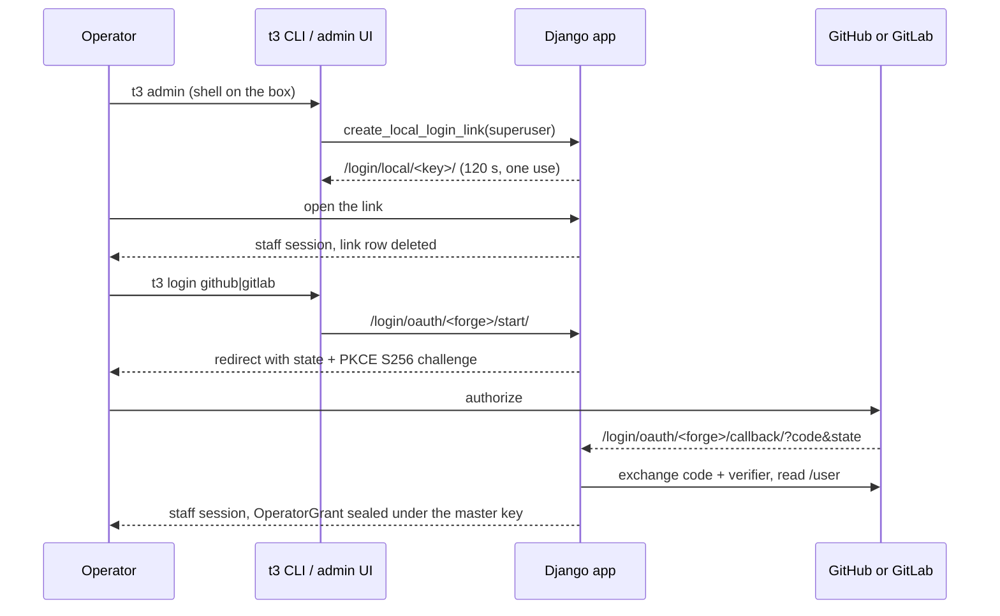

# BLUEPRINT Appendix — Operators, sign-in and per-person grants (#5122)

Detail behind [BLUEPRINT.md](https://github.com/souliane/teatree/blob/main/BLUEPRINT.md) §4 ("Operator identity"). The rule it implements: the bot does every write the factory owns, and a person's forge account is used only through that person's own OAuth grant, for the actions that must be that person.

## Who may reach the dashboard

- Every route of the production URLconf requires a signed-in staff session. `OperatorLoginRequiredMiddleware` (`core/middleware.py`) sits in the slot the loopback auto-login used to hold and answers an anonymous caller with a redirect to `/login/?next=…`, or `401` plus `HX-Redirect` for an HTMX request. The caller's address is never read, so a request that arrives through a tunnel or a host-networked container is as anonymous as any other.
- The public set is closed and pinned by `tests/test_urls.py`, which walks every route of the production URLconf anonymously (plain, with `X-Forwarded-For`, and as an HTMX request) and as a signed-in non-staff user: the login routes (`/login/`, `/login/local/…`, `/login/oauth/…`, `/admin/login/`), `/favicon.ico`, `/static/…`, and the two forge webhook receivers.
- The forge webhook receivers run in their own process (`teatree.webhook_wsgi`) whose `MIDDLEWARE` carries neither the login middleware nor session middleware; they verify the sender's signature and stay reachable without a session.
- Until roles exist, every operator is a Django superuser. Roles come later through Django's own groups and permissions. A superuser can edit any ticket's `requested_by` and any identity row in the Django admin, so the admin is not an isolation boundary between operators.

## Three ways in

- **Password.** `/login/` and `/admin/login/` are Django's admin login form. `T3_ADMIN_USER` / `T3_ADMIN_PASSWORD` seed the first superuser. With no OAuth app configured and no master key, this and the link below are the working paths, and `/admin/login/` answers `200` anonymously, which the deploy probes rely on.
- **Single-use link.** `t3 admin` and `t3 dashboard` mint a link through `core/operator_login.py`: a server-side session that holds only `local_link_user_id` and `local_link_next`, no Django authentication keys, so presented as a cookie it authenticates nobody. Consuming it deletes the session row, and the delete count is the single-use compare-and-swap: a replay, an expired link (120 seconds) and a link for a non-superuser all answer `403`. A `next` outside the request host is replaced with `/admin/`. The containerized CLI records the link in `BROWSE_URL_FILE` with mode `0600` for `deploy/t3` to open on the host.
- **Forge OAuth.** `t3 login github|gitlab`, or the buttons on the login page, start an authorization-code flow with PKCE (`S256`) and a one-use `state`, both held in the session for ten minutes and bound to the initiating user. A callback with a missing, wrong, replayed or expired state, or without the verifier, signs nobody in and exchanges nothing.

## Invitation: a first sign-in never grants rights

A forge account signs in only when an existing superuser has already attached its immutable forge account ID to a superuser through the Django admin's operator-identity inline. The callback matches `OperatorIdentity(platform, external_id)`, never the handle, so:

- an uninvited account creates neither a user nor an identity nor a grant (`403`);
- a renamed account keeps its user and the stored handle follows the rename;
- a recycled handle held by a different forge ID is refused;
- a rename onto a handle another approved account holds is refused and changes neither row.

`OperatorIdentity` also holds the person's Slack user ID (`platform="slack"`), which is how a ticket's requester becomes a Slack addressee.

## The grant

`OperatorGrant` (`core/models/operator_grant.py`) holds one row per `(user, forge)`: the access and refresh tokens sealed under the installation master key with the AAD `user/<id>:oauth:<forge>`, so a ciphertext moved to another operator's row fails decryption. The tokens are absent from `SealedSecret`, `ConfigSetting` and the environment, and the grant shows in the Django admin only as a read-only inline on its user (forge, scope, expiry), never its ciphertext. Sign-in is refused with a `503` naming `deploy/README.md` when the master key is unavailable.

- Scopes: GitHub `repo read:user offline_access`, GitLab `api`. GitLab approvals need `api`, so the guard is the code path below, not the scope.
- The OAuth app registration is the one dict setting `operator_oauth_apps` (`{forge: {client_id, client_secret_pass_key, redirect_uri[, base_url]}}`). The client secret stays in the bootstrap secret store, named by `client_secret_pass_key`. The callback must be `/login/oauth/<forge>/callback/` on an `https` origin, or on `localhost` / `127.0.0.1`.
- `operator_access_token` refreshes an expired access token under a row lock. A missing, expired or revoked grant raises an error that names the operator's forge and the `t3 login <forge>` remedy.
- `t3 logout <forge> [--user <name>]` refreshes if needed, revokes at the forge, reads `/user` again and requires `401`, and only then deletes the row. A failed revoke exits `1` and keeps the row.

## Requesters and routing

- `Ticket.requested_by` is a canonical `platform:handle` key. Blank means unknown and resolves to the configured owner. The migration writes no backfill, so every pre-existing ticket stays blank.
- `Ticket.record_requester` is a compare-and-swap (`UPDATE … WHERE requested_by=''`) and a later full `save()` of a stale object cannot erase it. Forge issue sync, loop issue intake, `workspace ticket` (the forge issue's author, read before the write lock), an unlinked GitLab MR, a Slack work message (the sender) and a work ticket filed from a conversation (inherited) each record the first requester.
- `core/notify_targets.addressee_for` is the one place the fallback lives: requester, then that person's active superuser identity, then its Slack identity, else the configured owner. A known requester without a Slack identity falls back to the owner with a visible `Requester:` label, and a failed delivery to a known requester is never re-sent to the owner.
- Only the owner's own DM gets the send-proxy self-DM carve-out. A registered operator's DM passes the send-proxy decision with strict redaction, and any other recipient is denied by default. The Slack backend's `dm_only` guard admits the owner and registered operator Slack IDs only.
- Inbound, the recorder, drain and answer cycle (`loop/owner_identity.py`) admit the owner and registered superuser operators; a message from anyone else is never recorded. A reply or tap binds only when its sender is the card's addressee. A registered operator may start new work from an unbound message (the ticket records `slack:<id>` as requester). Control verbs, priority directives and live-session steering stay owner-only.

## Acting as a person

GitLab MR approval and unapproval (`cli/review/operator_approval.py`) need all of: a recorded requester on the MR's ticket, that requester's unconsumed `OnBehalfApproval` for the exact action and target, and that requester's sealed grant. The API must report the same GitLab identity as the consent before the write. A failed write rolls the consent back unconsumed, the audit row carries the requester's identity key as `approver_id`, and neither the owner's stored token nor another operator's grant can stand in. `approve-live-post` verifies the Slack approval's author and channel against the same addressee.

## Bot-owned pushes

`self_forge_identities` declares bot logins by forge host. A repository under one of those logins is bot-owned. The core pre-push hook and the factory's two push paths require the credential to authenticate as that bot and every newly pushed commit to name the bot as author and committer, including their email local parts. An unreadable identity or commit range refuses the push. The interactive command hook refuses a raw push to a bot-owned repo and directs the agent through `t3 push`. Other repository namespaces keep their existing push rules.

`t3 doctor check` reads recent GitHub or GitLab push events for bot-owned repositories in the workspace and reports a human or unknown actor. A failed or saturated event read is a failed check, not a clean result. The forge APIs expose a bounded recent history, so this check detects visible past pushes; the pre-push gate is the enforcement boundary for future ones.
