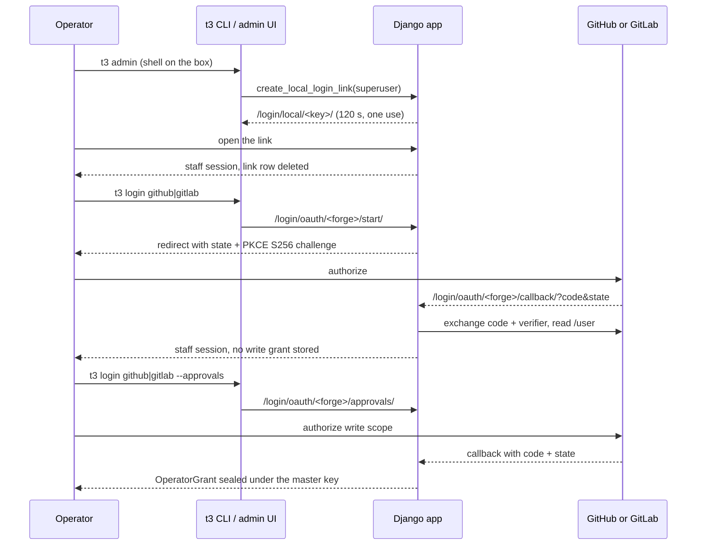

# BLUEPRINT Appendix — Operators, sign-in and per-person grants (#5122)

Detail behind [BLUEPRINT.md](https://github.com/souliane/teatree/blob/main/BLUEPRINT.md) §4 ("Operator identity"). The rule it implements: the bot does every write the factory owns, and a person's forge account is used only through that person's own OAuth grant, for the actions that must be that person.

## Who may reach the dashboard

- Every route of the production URLconf requires a signed-in staff session. `OperatorLoginRequiredMiddleware` (`core/middleware.py`) redirects an anonymous caller to `/login/?next=…`, or answers `401` plus `HX-Redirect` for an HTMX request. The caller's address is never read, so a request that arrives through a tunnel or a host-networked container is as anonymous as any other. Sessions and CSRF cookies on explicit ports are isolated by host and port.
- The public set is closed and pinned by `tests/test_urls.py`, which walks every route of the production URLconf anonymously (plain, with `X-Forwarded-For`, and as an HTMX request) and as a signed-in non-staff user: the login routes (`/login/`, `/login/local/…`, `/login/oauth/…`, `/admin/login/`), `/favicon.ico`, `/static/…`, and the two forge webhook receivers.
- The forge webhook receivers run in their own process (`teatree.webhook_wsgi`) whose `MIDDLEWARE` carries neither the login middleware nor session middleware; they verify the sender's signature and stay reachable without a session.
- Until roles exist, every operator is a Django superuser. Roles come later through Django's own groups and permissions. The ticket admin is read-only and preserves `requested_by` on saves; a superuser can manage operator identity rows, so the admin is not an isolation boundary between operators.

## Three ways in

- **Password.** `/login/` and `/admin/login/` are Django's admin login form. `T3_ADMIN_USER` / `T3_ADMIN_PASSWORD` seed the first superuser. With no OAuth app configured and no master key, this and the link below are the working paths, and `/admin/login/` answers `200` anonymously, which the deploy probes rely on.
- **Single-use link.** With one superuser, `t3 admin` and `t3 dashboard` mint a link through `core/operator_auth/operator_login.py`: a server-side session that holds only `local_link_user_id` and `local_link_next`, no Django authentication keys, so presented as a cookie it authenticates nobody. Consuming it deletes the session row, and the delete count is the single-use compare-and-swap: a replay, an expired link (120 seconds) and a link for a non-superuser all answer `403`. A `next` outside the request host is replaced with `/admin/`. With several superusers, the CLI opens `/login/` and carries the destination through OAuth, rather than selecting an account. The containerized CLI records the browser URL in `BROWSE_URL_FILE` with mode `0600` for `deploy/t3` to open on the host.
- **Forge OAuth.** `t3 login github|gitlab`, or the buttons on the login page, start an identity-only authorization-code flow with PKCE (`S256`) and a one-use `state`, both held in the session for ten minutes and bound to the initiating user. A callback with a missing, wrong, replayed or expired state, or without the verifier, signs nobody in and exchanges nothing. A signed-in operator separately runs `t3 login <forge> --approvals` to grant write access.

## Invitation: a first sign-in never grants rights

A forge account signs in only when an existing superuser has invited it through the Django admin's operator-identity inline. An invitation may specify the immutable forge account ID or the handle before the first sign-in; the callback binds the account ID to a handle-only invitation after verifying the handle. Later callbacks match the immutable ID, so:

- an uninvited account creates neither a user nor an identity nor a grant (`403`);
- a renamed account keeps its user and the stored handle follows the rename;
- a recycled handle held by a different forge ID is refused;
- a rename onto a handle another approved account holds is refused and changes neither row.

`OperatorIdentity` also holds the person's Slack user ID (`platform="slack"`), which is how a ticket's requester becomes a Slack addressee.

## The grant

`OperatorGrant` (`core/models/operator_grant.py`) holds one row per `(user, forge)` only after separate approvals consent. It seals the access and refresh tokens under the installation master key with the AAD `user/<id>:oauth:<forge>`, so a ciphertext moved to another operator's row fails decryption. The tokens are absent from `SealedSecret`, `ConfigSetting` and the environment, and the grant shows in the Django admin only as a read-only inline on its user (forge, scope, expiry), never its ciphertext. Identity-only sign-in works without a master key; approvals consent reports the master-key remedy when that key is unavailable.

- Identity-only scopes: GitHub `read:user`, GitLab `read_user`. Separate approvals consent requests GitHub `read:user` (a GitHub App ignores scope and grants its configured permissions) or GitLab `api`. `token_for` demands the `api` scope for GitLab and none for GitHub, whose App permissions the forge enforces at write time.
- The OAuth app registration is the one dict setting `operator_oauth_apps` (`{forge: {client_id, client_secret_pass_key, redirect_uri[, base_url]}}`). The client secret stays in the bootstrap secret store, named by `client_secret_pass_key`. The callback must be `/login/oauth/<forge>/callback/` on an `https` origin, or on `localhost` / `127.0.0.1`.
- `operator_access_token` refreshes an expired access token outside the row lock and stores it only if the grant has not changed. A missing, expired or revoked grant names the operator's forge and the `t3 login <forge> --approvals` remedy. `OperatorGrant.token_for` requires the exact action, target and unconsumed approval consent before revealing a token for an on-behalf write.
- `t3 logout <forge> [--user <name>]` refreshes if needed, revokes at the forge, reads `/user` again and requires `401`, and only then deletes the row. A failed revoke exits `1` and keeps the row.

## Requesters and routing

- `Ticket.requested_by` is a canonical `platform:handle` key. Blank means unknown and resolves to the configured owner. The migration writes no backfill, so every pre-existing ticket stays blank.
- `Ticket.record_requester` is a compare-and-swap (`UPDATE … WHERE requested_by=''`) and a later full `save()` of a stale object cannot erase it. Forge issue sync, loop issue intake, `workspace ticket` (the forge issue's author, read before the write lock), an unlinked GitLab MR, a Slack work message (the sender) and a work ticket filed from a conversation (inherited) each record the first requester.
- `core/notify_targets.addressee_for` is the one place the fallback lives: requester, then that person's active superuser identity, then its Slack identity, else the configured owner. A known requester without a Slack identity falls back to the owner with a visible `Requester:` label, and a failed delivery to a known requester is never re-sent to the owner.
- Only the owner's own DM gets the send-proxy self-DM carve-out. A registered operator's DM passes the send-proxy decision with strict redaction, and any other recipient is denied by default. The Slack backend's `dm_only` guard admits the owner and registered operator Slack IDs only.
- Inbound, the recorder, drain and answer cycle (`loop/owner_identity.py`) admit the owner and registered superuser operators; a message from anyone else is never recorded. A reply or tap binds only when its sender is the card's addressee. A registered operator may start new work from an unbound message (the ticket records `slack:<id>` as requester). Control verbs, priority directives and live-session steering stay owner-only.

## Acting as a person

`t3 review approve` and `unapprove` (`cli/review/operator_action.py`) have one route: the consenting operator's own forge grant. No personal token (`$GITLAB_TOKEN`, an overlay token) is ever read for an approval.

- **Who the operator is.** The ticket's requester (`requested_by`). When the ticket records none, the one operator holding an unconsumed `OnBehalfApproval` for the exact target and action; two consenting operators, a bare (non-`platform:handle`) approver id, or no consent refuse with the `t3 review approve-on-behalf … --approver <platform:handle>` remedy. A Slack consent resolves to the same person's GitLab or GitHub identity through their `OperatorIdentity` rows. `--forge` names the forge, defaulting to the one declared for the repo, else GitLab.
- **GitLab** (`cli/review/operator_approval.py`) additionally needs a review note by the same identity before approval. The API must report the same GitLab identity as the consent before the write.
- **GitHub** (`cli/review/github_operator_approval.py`) submits one `APPROVE` review with the grant's token, then reads the reviews back and requires the operator's latest review to be `APPROVED`. The `/user` login must match the consent's identity before the write. There is no same-identity review-note precondition, because the factory's GitHub reviews are authored by the bot. GitHub has no un-approve call for the approver, so `unapprove --forge github` refuses and leaves the consent unconsumed. The grant needs a GitHub App with expiring user tokens and the Pull requests write permission: a classic OAuth app token carries no refresh grant and the approvals consent refuses it.
- **Write and audit.** Both forges share one claim, write, release-on-failure and audit tail (`claim_publish_audit`). A failed or unverified write releases the consent, and the audit row carries the operator's identity key as `approver_id`. A missing, expired or revoked grant refuses naming `t3 login <forge> --approvals`.
- **Boundary.** Review-note and draft posting still use the owner credential from `read_token`; only approvals moved onto the grant. `approve-live-post` verifies the Slack approval's author and channel against the same addressee.

## Bot-owned pushes

`self_forge_identities` declares bot logins by forge host. A repository under one of those logins is bot-owned. The core pre-push hook and the factory's two push paths require the credential to authenticate as that bot and every newly pushed commit to name the bot as author and committer, including their email local parts. An unreadable identity or commit range refuses the push. The interactive command hook refuses a raw push to a bot-owned repo and directs the agent through `t3 push`. Other repository namespaces keep their existing push rules.

`t3 doctor check` reads recent GitHub or GitLab push events for bot-owned repositories in the workspace and reports a human or unknown actor. A failed or saturated event read is a failed check, not a clean result. The forge APIs expose a bounded recent history, so this check detects visible past pushes; the pre-push gate is the enforcement boundary for future ones.

The legacy `GITLAB_TOKEN` bootstrap route remains available for private GitLab clones. Long-running roles with an undeclared or unreadable bot identity withhold that token at startup; container CLI dispatch refuses to use it until the identity is verified. Per-operator OAuth tokens stay in sealed database rows and never populate that route.
